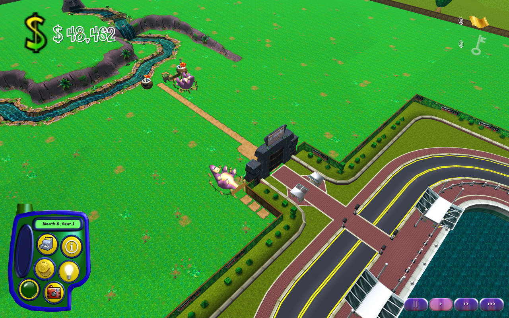

<p align="center">
    <h1 align="center">
        OpenTPW
    </h1>
    <p align="center">
        An open-source re-implementation of <a href="https://en.wikipedia.org/wiki/Theme_Park_World">Sim Theme Park / Theme Park World</a> (Bullfrog, 1999).
        <br>
        <a href="https://opentpw.io/">Website</a> |
        <a href="https://play.opentpw.io/">Play in the browser</a> |
        <a href="https://github.com/meneerkrabs/OpenTPW/releases">Downloads</a> |
        <a href="https://opentpw.io/docs/">Documentation</a>
    </p>
</p>



A native OpenTPW capture of the Lost Kingdom with the original textures and interface, rendered offscreen from the original game data.

## About this fork

This repository is a fork of [OpenTPW/OpenTPW](https://github.com/OpenTPW/OpenTPW), the project
started by Alex Guthrie and its contributors. Development there had slowed down, so we continued
the work here at a faster pace. We would much rather work together than apart: maintainers and
contributors of the original project are very welcome here, and we are happy to offer our changes
back upstream or to join efforts in whatever way works best. Open an issue or a discussion to talk.

For now our website is **[opentpw.io](https://opentpw.io/)**. Its [status page](https://opentpw.io/docs/status.html) is generated from this repository at every deploy (`tools/site_status.py`), and it has reading options (fonts, contrast, reduced motion).

For Theme Park Inc / Sim Coaster, use the [static launch and installation guide](https://opentpw.io/theme-park-inc.html): current desktop/browser steps, upcoming edition chooser availability and experimental limits.

## What OpenTPW is

OpenTPW runs Theme Park World on modern systems with a new engine. It reads the data of your own
copy of the original game. The engine does not ship the original executable or a playable set of
game files, and nothing from your installation is uploaded when you play in the browser.

**To run OpenTPW you need a full, legal copy of the original game** (an installation or the CD).

The aim is the original game, not a remake. Behaviour is traced from the original wherever
possible, and every place where OpenTPW still has to guess is tagged in the code and listed in
the [fidelity register](https://opentpw.io/docs/FIDELITY-REGISTER.html).

## Getting started

OpenTPW is a **development preview**, but most of the game already works: pick a world in the
original lobby, build a park with the original objects and run it with guests, staff and money.

- **In the browser:** open [play.opentpw.io](https://play.opentpw.io/) (Chrome, Edge, Firefox or
  Safari) and choose your Theme Park World folder. Nothing is installed and your files stay on your
  computer. The browser build is the newest part of OpenTPW: the front end, parks, sound and online
  play run there, and saves and settings stay in the browser between visits; movies and the
  developer panels are desktop-only for now ([web build](https://opentpw.io/docs/WEB.html)).
  First attraction/shop previews now load substantially faster through bounded LZSS
  copies and reused preview assets; first-use pauses remain ([measurements](https://opentpw.io/docs/BROWSER-PERFORMANCE.html)).
- **Download:** [stable releases](https://github.com/meneerkrabs/OpenTPW/releases), published automatically every hour from a green `main`, for Windows
  (x64, x86, ARM64), macOS (Apple silicon) and Linux (x64, ARM64). Unpack and start OpenTPW; on the
  first start it asks for your game folder. Follow the [installation guide](https://opentpw.io/install.html)
  for your platform ([releases](https://opentpw.io/docs/RELEASES.html), [setup](https://opentpw.io/docs/SETUP.html)).
- **From source:** install the .NET 11 SDK pinned in `global.json` (currently a release candidate, 11.0.100 RC2), then

  ```sh
  bash scripts/run.sh --game-path '/path/to/Theme Park World'
  ```

  or `./scripts/run.ps1` on Windows. See [running](https://opentpw.io/docs/RUNNING.html) for options such as
  `--sandbox`, `--language` and the native macOS libraries.

## Status

What works today, with your own original game data:

- **Start-up as on the CD:** the CD's autorun launcher (Play, View Read-me, Exit) and the original
  start-up movies, Bullfrog logo included ([autorun](https://opentpw.io/docs/AUTORUN.html); `--no-autorun`, `--no-intro`).
- **Front end and HUD:** the original 3D lobby with its islands, menus, the original-layout Game
  Options screen (OpenTPW's own settings sit on a separate page) and the in-game HUD, built from the
  original models, fonts and strings
  ([UI](https://opentpw.io/docs/UI.html)).
- **Languages:** twelve: English, US English, Danish, Dutch, French, German, Hebrew (right to left), Italian, Korean, Polish,
  Spanish and Swedish, a fan-made Russian, and the language of your CD or of the localisation pack once you choose its folder ([languages](https://opentpw.io/docs/LANGUAGES.html)).
- **Parks:** the four worlds with their original terrain; all 274 original objects can be built
  and run their original ride scripts and animations, and the official bonus objects can be added;
  players build their own roller coasters, and go-kart and water ride tracks with their jumps, tunnels and the Space Racers teleport
  ([objects](https://opentpw.io/docs/OBJECTS.html), [ride scripts](https://opentpw.io/docs/RSE-VM.html),
  [coasters](https://opentpw.io/docs/COASTERS.html), [tracks](https://opentpw.io/docs/TRACKS.html)).
- **Guests, economy and staff:** guests arrive, walk the paths and use rides, shops, sideshows and
  toilets. The 31 root scripts that use ADDHEAD in the fantasy, hallow, jungle and space themes can
  show riders' heads at the nodes the model's head records name, with the traced frame and roll, and so do the
  coaster trains, tour cars, karts, boats and bumper cars; the head size, depth and slot stream remain qualified
  (HEADS-001, 004, 005). Money, loans, wages, research, objectives, golden tickets and keys run on the original
  settings files ([guests](https://opentpw.io/docs/GUESTS.html), [economy](https://opentpw.io/docs/ECONOMY.html)). A hired staff member is
  placed with a click on the park, can be picked up and moved from the staff window, and is drawn with the original sprites
  ([staff placement](https://opentpw.io/docs/STAFF-PLACEMENT.html)).
- **Park door and rides:** the park door (the entry-price screen's door button, Ctrl-O and Ctrl-C) opens
  and closes the park: admissions stop at the booth, the rides close, and the entrance gate shuts once
  the park is empty ([park door](https://opentpw.io/docs/GATES.html)). A placed queue cell can be clicked to extend its ride's
  queue, and the selected ride can be ridden in a first-person view (E; Escape or a right click leaves
  it). These controls work in OpenTPW; their remaining original-game fidelity limits are documented
  ([guests](https://opentpw.io/docs/GUESTS.html), [UI](https://opentpw.io/docs/UI.html)).
- **Save and resume:** the pause menu's Save writes the whole running park — layout, guests, queues,
  ride scripts, money, staff and world state — in OpenTPW's own format, one slot per theme, and Load
  resumes it exactly where it left off: the same ids, queues and riders, the saved gameplay mode and
  start kind, the park open or closed as saved. This works in the app and in the browser, where the
  save persists between visits. A save is pinned to the game data it was made with: changed
  simulation assets refuse the load with a reason before the running park is touched. Roller coasters
  and prototype rides cannot be saved yet, and the original TPWS/TPWI format stays read-only
  ([park saves](https://opentpw.io/docs/PARK-SAVES.html)). A park in play is also autosaved every five
  minutes into its own slot per theme (an OpenTPW extra that never touches your manual save, on by
  default under Options, OpenTPW): after a crash the theme menu offers "Continue autosave"
  ([periodic autosave](https://opentpw.io/docs/PARK-SAVES.html#periodic-autosave)).
- **Advisor, music and movies:** the advisor speaks with lip sync for 234 of the 246 messages the original game gives (money, rides, litter, guest mood, staff, research, golden tickets, window and tool help; the full list is in `content/data/advisor-producers.toml`), plus 43 restored lines, the
  park and the front-end lobby play their original music, rides, the crowd and the interface play
  their original sounds, and all nine movies play. Placed ambients, rain and thunder, ride screams,
  staff voices, build-tool feedback, coaster crashes and a software reverb (OpenTPW's own by design) are wired. Focused real-data tests verify decoded
  PCM for forced weather and staff events; the native smoke runs did not reach their natural triggers
  ([audio](https://opentpw.io/docs/AUDIO.html), [lip sync](https://opentpw.io/docs/LIPS.html),
  [movies](https://opentpw.io/docs/TGQ-MOVIES.html)).
- **Online again:** accounts, park sharing, visiting, voting, postcards and chat parks, on the
  official server or one you host yourself. A shared park is the park as its owner built it (paths,
  queues, objects and player-built coasters in version 2 packages, with a layout digest checked on
  import). Visits show the published statistics read-only, use the shared ride camera for supported
  rides and allow voting. A visit shows the park's other visitors walking in it, with their names
  and chat, but does not synchronize the parks' simulations; the service and its protocol are
  OpenTPW implementations ([online](https://opentpw.io/docs/ONLINE.html),
  [server](https://opentpw.io/docs/SERVER.html)).
- **Modern systems:** native builds for Windows, macOS and Linux; any resolution and aspect ratio
  with a HiDPI-aware interface scale; button labels fitted per language; compatibility fixes from
  the community ([compatibility](https://opentpw.io/docs/COMPATIBILITY.html)).
- **Optional textures:** fresh settings use **Original world textures**. You can build an optional
  world-texture pack from your own copy on the desktop and switch to it in the options without a restart
  ([texture packs](https://opentpw.io/docs/TEXTURE-PACKS.html)). OpenTPW distributes no texture pack.
- **Extensions and mods:** OpenTPW's own additions (online play, swimming pools, restored advisor lines, an evening and night cycle)
  are official extensions you can switch off, and data mods, sandboxed script mods and local texture
  packs change the game without code ([below](#extensions-and-mods)).
- **Extras:** viewing and exporting the PlayStation 2 disc data (`--export-ps2`, [PS2](https://opentpw.io/docs/PS2.html)).

Not done yet: tour-car sounds (the four tour rides board, fly and release riders, [tours](https://opentpw.io/docs/TOURS.html)), the particle effects of the other
callers (ride smoke, litter; RSE EVENT types 1 and 2 are drawn, [particles](https://opentpw.io/docs/PARTICLES.html)),
additional staff actions (the guards' chase and escort, entertainer shows) and their sounds, the path tool's link-end and undo sounds, and the exact original rules in places where
OpenTPW still uses a documented approximation. The
[completion plan](https://opentpw.io/docs/COMPLETION-PLAN.html), [feature matrix](https://opentpw.io/docs/FEATURE-MATRIX.html) and
[progress](https://opentpw.io/docs/PROGRESS.html) track what remains.

### File formats

The **Decoding** column only says whether the bytes of the selected original-asset corpus are
understood: ✅ means every observed file decodes and every field the original game reads is understood
(fields it is shown to skip, such as the MAP header words, may stay raw); ⚠️ means some bytes or field
meanings that matter are still unknown. Whether the game *uses* a decoded file
the way the original does (triggers, gameplay, rendering, mixing) is listed separately under
"Not yet in the game", because that is engine work rather than a missing decoder. Neither symbol
certifies other editions or original-runtime parity.

| Format | Decoding | What decodes | Still open in the format | Not yet in the game |
|---|---|---|---|---|
| Textures ([.WCT](https://opentpw.gu3.me/formats/wct.html)) | ✅ | Every texture of the selected game, with bounded inflation and the retail BILZ/LZSS quirks | Other editions are unverified | — |
| Settings ([.SAM](https://opentpw.gu3.me/formats/sam.html)) | ✅ | The line grammar of every shipped `.sam` file, loose and in WADs: one-token or quoted values, `#`/`//` comments and `---` blocks; the generic reader agrees with the object reader on all of them | — | How the original uses many keys is approximate |
| Sounds ([.SDT](https://opentpw.gu3.me/formats/sdt.html), .MP2) | ✅ | SDT containers, entry headers (type bits, bit depth, the playback length the game cuts each sound to) and sound catalogues; all audio: MPEG-1/2 Layer I and II in every observed mode (≤1 LSB against an independent decoder), CRC checks and de-emphasis | — (modes no shipped file uses (Layer III, MPEG-2.5, free format, MPEG-2 Layer II joint stereo, are refused) | — (the room reverb is OpenTPW's own stand-in by design, `EXT:audio-reverb`: the original's lives in the sound device) ([sound](https://opentpw.io/docs/AUDIO.html), [audio evidence](https://opentpw.io/docs/LIPS.html)) |
| Strings ([.BFMU](https://opentpw.gu3.me/formats/bfmu.html), [.BFST](https://opentpw.gu3.me/formats/bfst.html), [.BFUM](https://opentpw.gu3.me/formats/bfum.html)) | ✅ | 21 string tables per language; single-byte and two-byte (Polish, Korean, Hebrew) character tables, round-trip tested and read in twelve languages and the fan Russian | Other codepages/editions are unverified ([languages](https://opentpw.io/docs/LANGUAGES.html)) | — |
| Fonts ([.BF4](https://opentpw.gu3.me/formats/bf4.html)) | ✅ | All 33 fonts in six languages, and the Polish, Spanish, Korean (17,270-glyph), US English, Italian, Hebrew and fan Russian fonts (four-bit, RLE, monochrome) | — | Original text layout/appearance is unverified ([fonts](https://opentpw.io/docs/BF4-FONTS.html), [UI](https://opentpw.io/docs/UI.html)) |
| Lip Sync ([.LIP](https://opentpw.gu3.me/formats/lips.html)) | ✅ | Mark lists, signed conversion, talking toggles; checked against all 639 English global clips (638 end inside their audio) | — | Advisor animation/pose and a pausing clock ([lip sync](https://opentpw.io/docs/LIPS.html), [binary trace](https://opentpw.io/docs/reverse/APPROX-TRACE.html)) |
| Models ([.MD2](https://opentpw.gu3.me/formats/m3d2.html)) | ✅ | 2,116/2,118 WAD members (the two 207.201 members and the two loose 24.23 arrows are refused by the original loader too); all 1,278 animation members: position/rotation/scale, quantised vertex groups, the 12-byte pose block, texture-coordinate and texture-frame tracks, node-flag toggles, path parameters and the models' paths (Bézier, linear, Catmull-Rom) | — (slot bits 0x10/0x20 mean wrap, the rest clamp; 0x1/0x2 have no reader; [models](https://opentpw.io/docs/MD2-MODELS.html)) | The terrain's texture turn and mirror and the per-mesh culling boxes are not drawn; PC equivalence and rendering fidelity are unverified |
| Map Data ([.MAP](https://opentpw.gu3.me/formats/map.html)) | ✅ | All five TP2M terrain grids: grid mapping and every cell bit the game reads, as tp.exe's loader reads them (bit 0x04, the five header words and jungle `terrain.map` are never used by it); the sound-catalogue MAPs are a separate, decoded format | — | — |
| Ride Scripts ([.RSE](https://opentpw.gu3.me/formats/rsse.html)) | ✅ | All 308 scripts; all 84 used opcodes known with their operand counts; the 52 hooked handlers (39 used by the shipped scripts) read from `tp.exe`, operands and flags included, and served by the game systems: visitors, animation, sounds and the object records they keep, particles, the ride controllers, the clock, the object type's own sound list (ADDOBJ/EVENT type 10 play from the `cat_ride` category an object archive carries; no shipped script uses it, a mod's can) and the object lights (the four light opcodes switch, dim and colour a model's light dummies, an OpenTPW addition, `[EXT:object-lights]`; no shipped script or model uses them, a mod's can); `End.RSE`'s end-of-park finale in Instant Action and the Full Simulation, with the original winning screen | The operands of the hooked handlers are read from the executable ([VM](https://opentpw.io/docs/RSE-VM.html)) | — |
| Save Files ([.TPWS](https://opentpw.gu3.me/formats/tpws-ints-lays.html)) | ⚠️ | The TPWI container's 19 writer-order blocks; cell grid, placed objects, park turn and date, bank, staff, guests, research and advisor state | Guests that are queued, boarding or riding, RNG state and the script/particle/sound blocks (SAVE-001–010) ([payload](https://opentpw.io/docs/TPWS-PAYLOAD.html), [inventory](https://opentpw.io/docs/reverse/SAVE-plan.html)) | Original-format saves are read, never written; OpenTPW saves [its own format](https://opentpw.io/docs/PARK-SAVES.html) |
| Banner mesh companions ([.MTR](docs/MTR.md)) | ✅ | Observed structure: topology and the nine matrices of every observed file (17 copies, 15 distinct; the 11 European copies are pinned) | None in the decoded bytes; open: whether anything reads them (no reader found in any allowed binary, a runtime-built filename can't be fully excluded), why `s` is 0.66596/0.80645/1 and what `M7` is (no placement code was found) | — (no consumer found) |
| Video ([.TQI/.TGQ](https://opentpw.gu3.me/formats/tqi.html)) | ✅ | All nine movies; audio bit-exact; video through the PC game's own decoder (dequantisation matrix, transposed scan, transform passes, 7-bit samples and colour tables), matching the original routines run in the x86 oracle | — ([movies](https://opentpw.io/docs/TGQ-MOVIES.html)) | Game trigger points; `--play-movie` plays them |
| Theme Park Inc textures (.FSH, EA `SHPI`) | ✅ | All 7,283 `.fsh` files/WAD members to RGBA (`--inspect-fsh`); the 24-bit palettes store no alpha and decode opaque, as the executable's own converter (`Game.exe` `0x6B7000`) does | The one 16-bit (`0x2D`) palette has no original reading and is OpenTPW's choice, `[EXT:fsh-0x2d-palette]` ([FSH](https://opentpw.io/docs/FSH.html)) | — |

The experimental Theme Park Inc native slice (`[EXT:tpi-viewer]`, `--load-original-level
arabian|science|water`) is a game mode, not a format: it builds and runs guests with its own HUD,
terrain, paths, models and sound; economy, staff, campaign, advisor, saves and sharing are disabled,
and no original TPI parity is claimed ([slice](https://opentpw.io/docs/THEME-PARK-INC.html#theme-park-inc-playable-slice)).
The [format backlog](https://opentpw.io/docs/FORMAT-BACKLOG.html) lists each format's open questions.

File format notes are also available on the [OpenTPW formats](https://opentpw.gu3.me/formats/)
website, a work in progress from the original project.

## Extensions and mods

OpenTPW has two kinds of add-ons, both switched on and off on **Options > OpenTPW > Extensions and mods**
(official extensions apply to the next park you start or load, community mods at the next start; [extensions and mods](https://opentpw.io/docs/MODS.html)):

- **Official extensions** are OpenTPW features that live in this repository and can be switched off. They are
  OpenTPW's own, not original behaviour, and are labelled `[EXT]` in the code. Online play, the restored advisor lines and pools are on by default.

  | Extension | Default | What it does |
  |---|---|---|
  | `opentpw.online` | on | Online play ([online](https://opentpw.io/docs/ONLINE.html)); it makes no network request until you act. |
  | `opentpw.pools` | **on** | Swimming pools: paint pool water, build changing rooms, extras (ladders, diving boards, showers, loungers, lamps, underwater lights), water slide towers and water attractions (rope swing, water jets, wave machine, small and large spa), a lazy river, and guests who swim in their own swimwear animations. Not in a Theme Park Inc run ([pools](https://opentpw.io/docs/POOLS.html)). |
  | `opentpw.pools-guest-art` | on | With pools on, land guests are drawn with OpenTPW's own 2x kid and head sprites; switch it off for the original guests. Presentation only. |
  | `opentpw.umbrellas` | **on** | A brolly shop in every theme and guests who buy an open umbrella in the rain, from a trace of Theme Park Inc's rules ([umbrellas](https://opentpw.io/docs/UMBRELLAS.html)). Simulation only for now: the umbrellas are not drawn yet. |
  | `opentpw.restored-advice` | on | Advisor lines that exist in the game's data but that the original program never plays. |
  | `opentpw.evening` | **on** | A day and night cycle on play time (10, 20 or 40 minutes, or always day, dusk or night, set on the OpenTPW options page): the sky, ground and water darken and lamps, pool lights and a few ride lights switch on at dusk ([evening](https://opentpw.io/docs/EVENING.html)); the cycle is presentation only. It also adds a cheap torch to every theme's Features tab; a park save records the extension only while the park has a torch. |
  | `opentpw.winter-snow` | **on** | Snow settles on the ground, roofs and objects while it snows and melts afterwards, with the paths turning to slush ([winter](https://opentpw.io/docs/WINTER.html)). Presentation only. |
  | `opentpw.guest-insights` | off | Counts why guests refuse rides and shops in the park information window. |
  | `opentpw.cross-edition-objects` | off | The engine support for a mod that brings Theme Park Inc attractions into Theme Park World (the shipped mod `opentpw.tpi-rides` is off too). |
  | `opentpw.smarter-guests` | off | Guests that decide better: dear shops, spread-out queues, patience, needs, cleaner and quieter paths, litter carried to a bin (RollerCoaster Tycoon-inspired ideas, no code). Changes the simulation, so a park saved with it needs it. |

- **Community mods** are folders with an `opentpw-mod.json` manifest, off until you switch them on. A mod can replace
  game files (overrides), replace string tables (strings), add objects and carry scripts.

**Pools are on by default.** The pools extension lets you paint pool water of any shape on the park, build water
slides and pool attractions (rope swing, jets, spa, wave machine, lazy river), and guests change in a changing room and really swim. It comes with
its own content, made for OpenTPW and containing nothing from the original: textures, changing-room objects, and hi-res (2x) visitor sprites with their own swim
animations for swimmers. The same switchable **Pool guest art** extension (also on by default) draws land guests with OpenTPW's own 2x sprites too; off, they are the original guests. Switch pools off on
the Extensions and mods screen or with `--disable-extension opentpw.pools`. It is not available in Theme Park Inc runs, and a park saves its pool
record only when it has pool water, so a park without water is unchanged ([pools](https://opentpw.io/docs/POOLS.html)).

- **Texture packs** are optional: you build a world-texture pack from your own copy of the game on the desktop, and OpenTPW
  distributes none ([texture packs](https://opentpw.io/docs/TEXTURE-PACKS.html)).
- **Data mods** use `overrides` (replace any game file), `strings` and `objects`. They work on the desktop and, for the mods shipped with the page, in the browser. OpenTPW ships one,
  Theme Park Inc rides in Theme Park World, which needs your own copy of Theme Park Inc and is off by default.
- **Script mods** are written in TPW Script, OpenTPW's own small language, and can change guest decisions such as which ride a guest prefers or when it gives up a queue.
  It is not Lua, and mods never load native code, because the simulation must stay deterministic, saves must resume exactly, and the browser build is compiled ahead of time and
  cannot load code. The four guest hooks work on the desktop; the browser does not run script mods yet ([script mods](https://opentpw.io/docs/SCRIPT-MODS.html)).
- A park save records the mods that change the simulation and refuses to load without them.

To make a mod, start with the [modding guide](https://opentpw.io/docs/MODDING-GUIDE.html): folder layout, a minimal manifest, where to put the folder on
Windows, macOS and Linux, and examples.

## Research on the original game

Game rules count as original only with evidence: the original data files, the manual, or static
analysis of the original program. The Mac PowerPC build of Theme Park World ships unprotected and
with many named functions, so most rules are traced there with Ghidra; findings, addresses and
open questions are written down in [reverse findings](https://opentpw.io/docs/reverse/FINDINGS.html). The provenance
rules are in the [completion plan](https://opentpw.io/docs/COMPLETION-PLAN.html). Original binaries, decompiled code and
game files never go into this repository.

## Goals

1. **Theme Park World**: the complete original offline game. This is the primary goal; it is in
   progress and not yet complete ([completion plan](https://opentpw.io/docs/COMPLETION-PLAN.html)).
2. **Online play as in the original game**: sharing, visiting and voting on parks, postcards and
   chat parks with live presence, movement and the original chat commands. The original servers are
   gone and their protocol is not reconstructed, so OpenTPW provides its own opt-in, self-hostable
   service ([online](https://opentpw.io/docs/ONLINE.html), [what the original had](https://opentpw.io/docs/reverse/ONLINE-FEATURES.html)).
3. **Theme Park Inc / Sim Coaster**: a separate, later goal. Both games share most file formats and
   closely related ride-script formats ([comparison](https://opentpw.io/docs/THEME-PARK-INC.html)), but Theme Park Inc
   has an experimental native build/guest slice; its full campaign, economy and saves remain future work.
4. **Sandbox modes** (an OpenTPW extension, not original behaviour): free building with Theme Park
   World content, Theme Park Inc content, or both. Planned; today's `--sandbox` uses Theme Park
   World content only.

## Contributing

Contributions are very welcome: code, research on the original game, bug reports and testing on
your own edition of the game.

1. Fork this repository and create a branch, for example `yourname/feature-name`.
2. Keep repository text in English, never commit original game files or binaries, and tag every
   behaviour you could not trace to the original as an approximation (see the
   [fidelity register](https://opentpw.io/docs/FIDELITY-REGISTER.html)).
   `python3 tools/fidelity_register.py --check` validates the tags and their declarations;
   `python3 tools/fidelity_register.py --write` generates the register locally as
   `docs/FIDELITY-REGISTER.md`. That file is a build artifact: it is not committed, and the website
   publishes the copy generated from `main`. When an ID is retired, `--write` also records it in
   `tools/fidelity_retired.txt`, which is committed.
3. Describe your change for the progress log in a new file of its own,
   `docs/progress/YYYY-MM-DD-<slug>.md` (date and a short lowercase slug, for example
   `docs/progress/2026-10-16-buy-window-scroll-bar.md`). Its first line is the entry heading
   `## Title (Month D, YYYY)` with the same date; use `###` or deeper inside the entry, and write relative
   links as seen from `docs/progress/` (for example `../TRACKS.md`). Do not
   edit the top of `docs/PROGRESS.md`: it is the frozen history from before this convention.
   `python3 tools/progress.py --check` validates the fragments, and `python3 tools/progress.py`
   prints the assembled log (newest first) that the website publishes as the
   [progress notes](https://opentpw.io/docs/PROGRESS.html). One file per pull request means
   parallel pull requests never conflict over the log.
4. Run the tests (`dotnet test source/OpenTPW.Tests`; tests that need original files run when
   `OPENTPW_GAME_PATH` points at your game folder) and open a pull request.

## Legal

OpenTPW is not affiliated with or endorsed by Electronic Arts or Bullfrog Productions. Theme Park
World and Sim Theme Park are trademarks of their respective owners. OpenTPW contains no original
executable code or playable original-game installation; you need your own legal copy of the game
to play. Local pack-building tools remain available ([texture packs](https://opentpw.io/docs/TEXTURE-PACKS.html)). The engine's MIT licence does not grant rights to the
original game assets or trademarks.

## License

MIT; see [LICENSE.md](LICENSE.md). `source/OpenTPW.Files/Formats/Compression/ClassicZlibDeflater.cs` is a port of zlib 1.1.3's deflate
and keeps zlib's copyright and license notice in its header.
